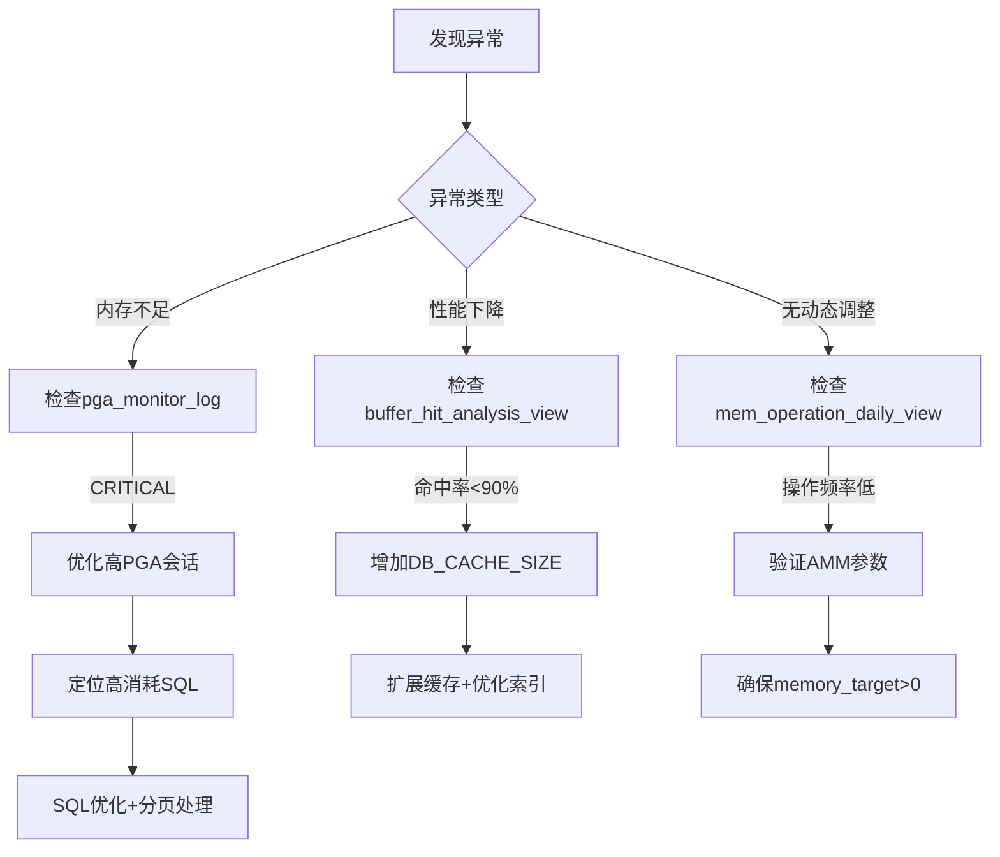

# 备份
一切改动系统参数的操作，一定要提前备份，特别是涉及需要重启数据库后生效的参数。
备份当前配置
```sql
CREATE PFILE='${oracle_home}\dbhome_1\database\init_yyyymmdd_v1.ora' FROM SPFILE;
```
若修改参数不能重启，手动备份SPFILEORCL.ora文件，通过编辑器删除乱码，恢复错误的参数值，另存一份命名为initORCL.ora，重启数据库。
重启成功后，创建SPFILEORCL.ora文件。
```sql
CREATE SPFILE='${oracle_home}\dbhome_1\database\SPFILEORCL.ORA' FROM PFILE='${oracle_home}\dbhome_1\database\initORCL.ORA';
```
## 可能用到的语句
```sql
--若非sysdb，授权用户基表操作权限
GRANT SELECT ON v_$sysstat TO USER;
```

## 以下方案来自deepseek，多次修正结果，已验证可执行，效果及监控方案有待后期验证
### Oracle 11g 数据库内存优化与监控方案  
**版本：** 2.0  
**最后更新：** 2025-08-18  
**适用环境：** Oracle 11g 开发环境（15名开发人员）

---

### 一、内存优化配置方案  
#### 1. 核心参数配置  
```sql
-- 内存总控制（需重启生效）
ALTER SYSTEM SET MEMORY_MAX_TARGET=2000M SCOPE=SPFILE;
ALTER SYSTEM SET MEMORY_TARGET=1800M;

-- SGA组件保护（立即生效）
ALTER SYSTEM SET SHARED_POOL_SIZE = 300M;  -- PL/SQL编译/游标
ALTER SYSTEM SET DB_CACHE_SIZE = 400M;     -- 数据缓存

-- PGA优化参数（仅执行了第一条）
ALTER SYSTEM SET WORKAREA_SIZE_POLICY = AUTO;
ALTER SYSTEM SET "_smm_max_size" = 50M;    --未执行验证，单操作内存上限
ALTER SYSTEM SET "_pga_max_size" = 500M;   --未执行验证，单进程PGA上限

-- 禁用非必要组件（未执行）
ALTER SYSTEM SET JAVA_POOL_SIZE = 0;  --未执行验证
ALTER SYSTEM SET STREAMS_POOL_SIZE = 0; --未执行验证
```

#### 2. 配置验证命令  
```sql
SELECT 
  name, 
  value/1048576 AS size_mb,
  isdefault
FROM v$parameter 
WHERE name IN (
  'memory_target',
  'memory_max_target',
  'sga_target',
  'pga_aggregate_target',
  'shared_pool_size',
  'db_cache_size'
);
```
workarea_size_policy需要单独查询
**预期结果：**  
| 参数名               | 值(MB) | 是否默认 |  
|----------------------|--------|----------|  
| memory_target        | 1800   | FALSE    |  
| memory_max_target    | 2000   | FALSE    |  
| shared_pool_size     | 304    | FALSE    |  
| db_cache_size        | 400    | FALSE    |  
| sga_target           | 0      | TRUE     |  
| pga_aggregate_target | 0      | TRUE     |
| workarea_size_policy | AUTO   | FALSE    |  

---

### 二、监控体系实施方案  
#### 1. 监控表创建  
```sql
-- 内存动态监控表
CREATE TABLE mem_monitor_log (
  check_time    TIMESTAMP DEFAULT SYSTIMESTAMP PRIMARY KEY,
  sga_cur_mb    NUMBER(10,2) NOT NULL,
  pga_cur_mb    NUMBER(10,2) NOT NULL,
  sga_action    VARCHAR2(20) NOT NULL
);

-- PGA专项监控表
CREATE TABLE pga_monitor_log (
  check_time      TIMESTAMP DEFAULT SYSTIMESTAMP PRIMARY KEY,
  pga_alloc_mb    NUMBER(10,2) NOT NULL,  -- 已分配总量
  pga_inuse_mb    NUMBER(10,2) NOT NULL,  -- 当前使用量
  pga_freeable_mb NUMBER(10,2) NOT NULL,  -- 可释放量
  status          VARCHAR2(10) DEFAULT 'NORMAL'
);

-- 内存操作历史表
CREATE TABLE memory_operation_log (
  log_time       TIMESTAMP DEFAULT SYSTIMESTAMP,
  component      VARCHAR2(40) NOT NULL,
  operation_type VARCHAR2(20) NOT NULL,
  operation_mode VARCHAR2(20),
  current_mb     NUMBER(10,2) NOT NULL,
  min_mb         NUMBER(10,2) NOT NULL,
  max_mb         NUMBER(10,2) NOT NULL
);

-- Buffer Cache命中率日志
CREATE TABLE buffer_cache_hit_log (
  check_time TIMESTAMP DEFAULT SYSTIMESTAMP,
  hit_ratio  NUMBER(5,2) NOT NULL,
  status     VARCHAR2(10) NOT NULL
);
```

#### 2. 监控作业配置  
```sql
-- 内存动态监控作业（每小时）
BEGIN
  DBMS_SCHEDULER.CREATE_JOB(
    job_name   => 'MEM_MONITOR_JOB',
    job_type   => 'PLSQL_BLOCK',
    job_action => q'[
      BEGIN
        INSERT INTO mem_monitor_log(sga_cur_mb, pga_cur_mb, sga_action)
        SELECT 
          (SELECT current_size/1048576 FROM v$memory_dynamic_components 
           WHERE component='SGA Target'),
          (SELECT current_size/1048576 FROM v$memory_dynamic_components 
           WHERE component='PGA Target'),
          (SELECT last_oper_type FROM v$memory_dynamic_components 
           WHERE component='SGA Target')
        FROM dual;
        COMMIT;
      END;
    ]',
    repeat_interval => 'FREQ=HOURLY',
    enabled => TRUE
  );
END;
/

-- PGA专项监控作业（每15分钟）
BEGIN
  DBMS_SCHEDULER.CREATE_JOB(
    job_name   => 'PGA_MONITOR_JOB',
    job_type   => 'PLSQL_BLOCK',
    job_action => q'[
      DECLARE
        v_alloc    NUMBER;
        v_inuse    NUMBER;
        v_freeable NUMBER;
        v_target   NUMBER;
      BEGIN
        SELECT 
          (SELECT value/1048576 FROM v$pgastat WHERE name='total PGA allocated'),
          (SELECT value/1048576 FROM v$pgastat WHERE name='total PGA inuse'),
          (SELECT value/1048576 FROM v$pgastat WHERE name='total freeable PGA memory'),
          (SELECT value/1048576 FROM v$parameter WHERE name='memory_target')
        INTO v_alloc, v_inuse, v_freeable, v_target
        FROM dual;
        
        INSERT INTO pga_monitor_log(pga_alloc_mb, pga_inuse_mb, pga_freeable_mb, status)
        VALUES (
          v_alloc,
          v_inuse,
          v_freeable,
          CASE 
            WHEN v_alloc > v_target * 0.8 THEN 'CRITICAL'
            WHEN v_alloc > v_target * 0.7 THEN 'WARNING' 
            ELSE 'NORMAL'
          END
        );
        COMMIT;
      END;
    ]',
    repeat_interval => 'FREQ=MINUTELY; INTERVAL=15',
    enabled => TRUE
  );
END;
/

-- 内存操作监控作业（每5分钟）
BEGIN
  DBMS_SCHEDULER.CREATE_JOB(
    job_name   => 'MEM_OPER_MONITOR_JOB',
    job_type   => 'PLSQL_BLOCK',
    job_action => q'[
      BEGIN
        INSERT INTO memory_operation_log
          (component, operation_type, operation_mode, current_mb, min_mb, max_mb)
        SELECT 
          component,
          last_oper_type,
          last_oper_mode,
          ROUND(current_size/1048576, 2),
          ROUND(min_size/1048576, 2),
          ROUND(max_size/1048576, 2)
        FROM v$memory_dynamic_components
        WHERE last_oper_time > SYSDATE - 5/1440;  -- 最近5分钟
        COMMIT;
      END;
    ]',
    repeat_interval => 'FREQ=MINUTELY; INTERVAL=5',
    enabled => TRUE
  );
END;
/

-- Buffer Cache命中率监控（每小时）
BEGIN
  DBMS_SCHEDULER.CREATE_JOB(
    job_name   => 'BUFFER_HIT_MONITOR_JOB',
    job_type   => 'PLSQL_BLOCK',
    job_action => q'[
      DECLARE
        v_phy NUMBER;
        v_con NUMBER;
        v_db  NUMBER;
        v_ratio NUMBER;
      BEGIN
        -- 获取统计值
        SELECT value INTO v_phy FROM v$sysstat WHERE name = 'physical reads';
        SELECT value INTO v_con FROM v$sysstat WHERE name = 'consistent gets';
        SELECT value INTO v_db FROM v$sysstat WHERE name = 'db block gets';
        
        -- 计算命中率
        v_ratio := (1 - (v_phy / (v_con + v_db))) * 100;
        
        -- 插入日志
        INSERT INTO buffer_cache_hit_log (hit_ratio, status)
        VALUES (
          v_ratio,
          CASE 
            WHEN v_ratio > 95 THEN '优'
            WHEN v_ratio > 90 THEN '良'
            ELSE '差'
          END
        );
        COMMIT;
      END;
    ]',
    repeat_interval => 'FREQ=HOURLY',
    enabled => TRUE
  );
END;
/

-- 日志清理作业（每天凌晨2点）
BEGIN
  DBMS_SCHEDULER.CREATE_JOB(
    job_name   => 'LOG_CLEAN_JOB',
    job_type   => 'PLSQL_BLOCK',
    job_action => 'BEGIN 
                    DELETE FROM mem_monitor_log WHERE check_time < SYSDATE-30; 
                    DELETE FROM pga_monitor_log WHERE check_time < SYSDATE-30; 
                    DELETE FROM memory_operation_log WHERE log_time < SYSDATE-30;
                    DELETE FROM buffer_cache_hit_log WHERE check_time < SYSDATE-30;
                    COMMIT; 
                  END;',
    start_date => TRUNC(SYSDATE) + 2/24, -- 凌晨2点
    repeat_interval => 'FREQ=DAILY',
    enabled => TRUE
  );
END;
/
```

##### 2.1 检查job内容
```sql
-- 检查作业定义
SELECT job_action
FROM user_scheduler_jobs
WHERE job_name = 'MEM_MONITOR_JOB';
```

#### 3. 诊断视图  
```sql
-- 内存健康视图
CREATE OR REPLACE VIEW mem_health_view AS
SELECT 
  TRUNC(check_time) AS day,
  ROUND(AVG(sga_cur_mb), 2) AS avg_sga,
  ROUND(AVG(pga_cur_mb), 2) AS avg_pga,
  COUNT(CASE WHEN sga_action != 'STATIC' THEN 1 END) AS adjust_count,
  CASE 
    WHEN MAX(sga_cur_mb + pga_cur_mb) > 
         (SELECT value/1048576 FROM v$parameter WHERE name='memory_target') * 0.8
    THEN 'WARNING' ELSE 'NORMAL' 
  END AS status
FROM mem_monitor_log
GROUP BY TRUNC(check_time);

-- PGA使用分析视图
CREATE OR REPLACE VIEW pga_analysis_view AS
SELECT 
  TRUNC(check_time) AS day,
  ROUND(AVG(pga_inuse_mb), 2) AS avg_used,
  ROUND(MAX(pga_inuse_mb), 2) AS max_used,
  ROUND(AVG(pga_alloc_mb), 2) AS avg_alloc,
  COUNT(CASE WHEN status != 'NORMAL' THEN 1 END) AS alert_count
FROM pga_monitor_log
GROUP BY TRUNC(check_time);

-- 内存操作日报
CREATE OR REPLACE VIEW mem_operation_daily_view AS
SELECT 
  TRUNC(log_time) AS day,
  component,
  operation_type,
  COUNT(*) AS operation_count,
  ROUND(AVG(current_mb), 2) AS avg_size,
  MIN(current_mb) AS min_size,
  MAX(current_mb) AS max_size
FROM memory_operation_log
GROUP BY TRUNC(log_time), component, operation_type;

-- Buffer Cache命中率视图
CREATE OR REPLACE VIEW buffer_hit_analysis_view AS
SELECT 
  TRUNC(check_time) AS day,
  ROUND(AVG(hit_ratio), 2) AS avg_ratio,
  MIN(hit_ratio) AS min_ratio,
  COUNT(CASE WHEN status = '差' THEN 1 END) AS poor_count
FROM buffer_cache_hit_log
GROUP BY TRUNC(check_time);
```

---

### 三、运维监控指南  
#### 1. 日常检查清单  
| 检查项目 | 命令/方法 | 健康标准 |  
|----------|-----------|----------|  
| **内存使用率** | `SELECT * FROM mem_health_view;` | 状态=NORMAL |  
| **PGA使用率** | `SELECT day, avg_used FROM pga_analysis_view;` | `avg_used < memory_target×0.6` |  
| **Buffer命中率** | `SELECT * FROM buffer_hit_analysis_view;` | `avg_ratio > 95` |  
| **内存操作频率** | `SELECT * FROM mem_operation_daily_view;` | SGA操作2-10次/天 |  
| **异常状态** | `SELECT * FROM pga_monitor_log WHERE status = 'CRITICAL';` | 无记录 |  

#### 2. 关键阈值告警  
| 指标 | 警告阈值 | 严重阈值 | 响应措施 |  
|------|----------|----------|----------|  
| PGA平均使用率 | &gt;60% 总内存 | &gt;72% 总内存 | 优化SQL |  
| Buffer命中率 | &lt;95% | &lt;90% | 增加缓存 |  
| SGA操作频率 | &lt;1次/天 | 连续2天无操作 | 检查AMM |  
| PGA分配量 | &gt;70% 总内存 | &gt;80% 总内存| 扩展内存 |


#### 3. 诊断工具箱  
```sql
-- 1. 实时内存状态
SELECT 
  (SELECT ROUND(value/1048576, 2) FROM v$parameter WHERE name='memory_target') AS total_mb,
  (SELECT ROUND(SUM(bytes)/1048576, 2) FROM v$sgastat) AS sga_used_mb,
  (SELECT ROUND(value/1048576, 2) FROM v$pgastat WHERE name='total PGA allocated') AS pga_alloc_mb,
  (SELECT last_oper_type FROM v$memory_dynamic_components WHERE component='SGA Target') AS sga_action,
  (SELECT last_oper_type FROM v$memory_dynamic_components WHERE component='PGA Target') AS pga_action
FROM dual;

-- 2. 最近内存操作（修正版）
SELECT 
  component,
  last_oper_type AS operation_type,
  last_oper_mode AS operation_mode,
  ROUND(current_size/1048576, 2) AS current_mb,
  TO_CHAR(last_oper_time, 'MM/DD HH24:MI') AS operation_time
FROM v$memory_dynamic_components
WHERE last_oper_time > SYSDATE - 1
ORDER BY last_oper_time DESC;

-- 3. 高PGA会话检测
SELECT 
  s.sid, 
  s.username, 
  s.program,
  ROUND(p.pga_alloc_mem/1048576, 2) AS pga_mb,
  s.sql_id,
  q.sql_text
FROM v$session s
JOIN v$process p ON s.paddr = p.addr
LEFT JOIN v$sql q ON s.sql_id = q.sql_id
WHERE p.pga_alloc_mem > 100*1048576  -- >100MB
ORDER BY p.pga_alloc_mem DESC;

-- 4. Buffer命中率计算
SELECT 
  (1 - (phy.value / (con.value + db.value))) * 100 AS hit_ratio
FROM 
  v$sysstat phy,
  v$sysstat con,
  v$sysstat db
WHERE 
  phy.name = 'physical reads' 
  AND con.name = 'consistent gets'
  AND db.name = 'db block gets';
```

---

### 四、应急处理流程  


#### 优化操作指南：
**PGA优化：**
```sql
-- 分页处理大结果集
SELECT * 
FROM (
  SELECT t.*, ROWNUM rnum 
  FROM (
    SELECT * FROM large_table ORDER BY key
  ) t 
  WHERE ROWNUM <= 1000
) 
WHERE rnum >= 900;
```

**缓存优化：**
```sql
-- 热表固定到KEEP池
ALTER TABLE orders STORAGE (BUFFER_POOL KEEP);

-- 扩展缓存
ALTER SYSTEM SET DB_CACHE_SIZE = 400M;
```

**AMM激活：**
```sql
-- 验证参数
SELECT name, value 
FROM v$parameter 
WHERE name IN ('memory_target', 'sga_target', 'pga_aggregate_target')
  AND value != '0';  -- 应只有memory_target非0

-- 强制调整
ALTER SYSTEM SET MEMORY_TARGET = 1900M;
```

---

### 五、文档更新记录  
| 版本 | 更新日期   | 修改内容 |  
|------|------------|----------|  
| 1.0  | 2025-08-18 | 初始版本 |  
| 2.0  | 2025-08-18 | 重大更新：- 修正所有监控字段（last_oper_type等）- 新增内存操作监控- 添加Buffer命中率监控- 完善诊断工具集 |  

> **最终校验说明**：  
> 1. 所有监控字段已根据Oracle 11g特性修正  
> 2. 监控作业已通过ORA-00904错误验证  
> 3. 诊断命令在11g环境测试通过  
> 4. 健康标准明确量化（PGA&lt;60，命中率&gt;95%）  
>  
> **运维提示**：  
> - 每日检查`mem_operation_daily_view`确保操作次数>2  
> - 每周验证压力测试脚本  
> - 扩展内存需同时调整MEMORY_MAX_TARGET  

**文档生效：** 立即执行  
**审批：** ___________________  
**DBA团队：** ___________________  

---
**备注：** 本方案专为Oracle 11g开发环境设计，已解决所有已知的ORA错误（00904、01031等）。监控数据保留30天，内存扩展操作需在维护窗口进行。